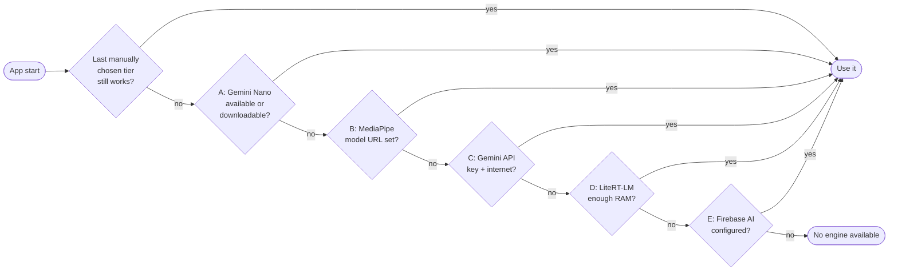

# nanodemo

> Versión en español: [README.es.md](README.es.md)

**nanodemo** is an Android demo (Kotlin + Jetpack Compose, multi-module clean
architecture) that runs the same chat on **five different AI engines** and
picks one automatically for the hardware it lands on. It tries the tiers in
order — on-device first, cloud as a safety net — and falls back to the next one
when the device (or the configuration) does not support the previous one. Every
engine lives in its own reusable Gradle module behind one `InferenceBackend`
contract, so the app doubles as a side-by-side comparison: force any tier, run
one prompt against all five at once, vote for the best answer, and export the
latency/token metrics to CSV. It came out of a research project on building AI
agents on mobile.

## Tiers

| Tier | Engine | Model | Runs | Hardware requirement | Latency / RAM / quality |
|---|---|---|---|---|---|
| A | ML Kit GenAI Prompt API (Gemini Nano via AICore) | Gemini Nano v3 | On-device, system-managed | 2026 flagships with ≥ 12 GB RAM (Pixel 10, Galaxy S26, OnePlus 15, ...) | Best on-device quality; model managed by the OS |
| B | MediaPipe LLM Inference | Gemma 3 1B / Gemma 2 2B (`.task`) | On-device, app-managed | Mid-range, ~4 GB+ RAM | Small models, 1024-token context; API is maintenance-only |
| C | Gemini REST API | Gemini Flash | Cloud | Any device with internet | Universal fallback; not on-device, metered |
| D | LiteRT-LM (successor of MediaPipe LLM Inference) | Gemma 4 E2B (`.litertlm`, ~2.6 GB) | On-device, app-managed, CPU or GPU | ~6 GB+ RAM | Supports images and persisted sessions |
| E | Firebase AI Logic | Gemini Flash | Cloud | Any device with internet + Firebase project | Google's recommended way to call Gemini from a mobile app |

Tiers D and E were added later to compare Google's newest engines; they sit at
the end of the fallback order so they never change the default pick. Switching
tiers frees the previous MediaPipe / LiteRT-LM engine so only one model stays in
RAM. Per-tier capabilities (top-P, max tokens, images, JSON mode, tools, web
search) are declared in each backend's `TierCapabilities` and the UI disables
unsupported controls instead of hiding them — see
[docs/AI_MODULES.md](docs/AI_MODULES.md).

## Fallback flow



A tier that needs a one-time step (downloading Gemini Nano, a `.task` or a
`.litertlm` file) shows a download button with progress instead of failing
silently. Every decision is logged under the `NanoDemo` Logcat tag
(`NanoDemo.MlKitNano`, `NanoDemo.MediaPipe`, `NanoDemo.CloudGemini`,
`NanoDemo.LiteRtLm`, `NanoDemo.FirebaseAI`).

## Features

The UI is localized: English by default (`values/`) with a Spanish translation
(`values-es/`), picked from the device language, and the layout supports RTL.
The prompts that steer the models (app context, tool and JSON instructions) and
the chat-stream notices (e.g. the search marker) are still Spanish only.

Multi-turn chat with Markdown streaming, image attachments (Photo Picker),
pasted-link context, generation parameters per tier (temperature, top-K/P, max
tokens, system prompt), JSON mode, function calling (native on C/E, prompt-emulated
on A/B/D), web search (native grounding on C/E, Brave Search on A/B/D),
compare mode across all five tiers with recommended prompts and voting, per-response
metrics (time to first token, total, tokens/s, model load time), a stats screen with
CSV export and estimated cloud cost, a Room-backed conversation history with
on-device semantic search (MediaPipe TextEmbedder), free-tier usage counters,
a context meter for the local engines, persisted settings, and a CPU/GPU selector
for LiteRT-LM. The full list is in the [Spanish README](README.es.md#qué-hace).

## Requirements

- Android Studio (recent stable) with JDK 21.
- Android SDK: `compileSdk` 37, `targetSdk` 36, `minSdk` 31.
- A **physical device**. Tier A needs a 2026 flagship with Gemini Nano v3;
  Tier B a mid-range phone with ~4 GB+ RAM; Tier D ~6 GB+ RAM; Tiers C and E any
  device with internet.
- Gradle 9.7, AGP 9.4, Kotlin 2.3 (built-in Kotlin of AGP 9, KSP, no kapt) —
  all pinned in `gradle/libs.versions.toml` and resolved by the wrapper.

## Setup

All keys are optional. Each one the build cannot find is compiled in as an empty
string and the corresponding tier is simply marked *unavailable*. The build reads
every key first from an **environment variable** (what `doppler run -- ./gradlew`
injects), then from **`local.properties`**, then falls back to the default.

1. Clone the repo and open it in Android Studio; let Gradle sync.
2. Create or edit `local.properties` (already in `.gitignore`; **never commit it
   or any key**):

   ```properties
   sdk.dir=/path/to/Android/sdk

   # Tier C — Gemini API key from https://aistudio.google.com/apikey
   GEMINI_API_KEY=your-key-here

   # Tier E — values from your Firebase project (Project settings → your Android app)
   FIREBASE_API_KEY=...
   FIREBASE_APP_ID=1:1234567890:android:abcdef
   FIREBASE_PROJECT_ID=...

   # Tier B — Gemma .task files hosted as assets of this repo's `models-v1` release
   # (public, no token needed; MEDIAPIPE_MODEL_TOKEN only for a private fork)
   MEDIAPIPE_MODEL_URL=https://api.github.com/repos/Sebas1705/nanodemo/releases/assets/566325429
   MEDIAPIPE_MODEL_URL_GEMMA_2_2B_PART1=https://api.github.com/repos/Sebas1705/nanodemo/releases/assets/566784090
   MEDIAPIPE_MODEL_URL_GEMMA_2_2B_PART2=https://api.github.com/repos/Sebas1705/nanodemo/releases/assets/566784089

   # Optional
   LITERTLM_MODEL_URL=            # Tier D, to point at another .litertlm model
   BRAVE_SEARCH_API_KEY=          # emulated web search on tiers A/B/D
   ANALYTICS_ENABLED=false        # Firebase Analytics / Crashlytics off in dev
   CRASHLYTICS_ENABLED=false
   ```

   The owner keeps these in a [Doppler](https://www.doppler.com) project
   (`nanodemo`, configs `dev` / `prd`); `scripts/doppler-sync-local-properties.sh`
   writes them into `local.properties` for Android Studio.
3. Tier D needs nothing: Gemma 4 E2B downloads from Hugging Face from the in-app
   "Download model" button. Tier E additionally needs Firebase AI Logic enabled
   in the Firebase console (no `google-services.json` or Gradle plugin: Firebase
   is initialised by hand from the values above).

### About the Tier C API key (demo only)

Tier C calls the public Gemini REST endpoint
(`generativelanguage.googleapis.com/v1beta/.../streamGenerateContent`) directly
with `HttpURLConnection`, because the official `google-genai` Kotlin SDK refuses
at runtime to build a client with an API key on Android and points to Firebase
AI Logic instead. That means **`GEMINI_API_KEY` is embedded in `BuildConfig`**
and anyone with the APK can extract it (same for `BRAVE_SEARCH_API_KEY` and the
Firebase values). This is acceptable for a local demo whose key never enters
git, but **not for a published app** — that is exactly what Tier E (Firebase AI
Logic, ideally with App Check) is for. The APK is therefore only distributed to
trusted testers through Firebase App Distribution, never as a GitHub Release.

## Build and run

```bash
export JAVA_HOME=/path/to/jdk-21 ANDROID_HOME=/path/to/Android/sdk
./gradlew :app:assembleDebug          # debug APK
./gradlew testDebugUnitTest           # JVM unit tests (all modules)
./gradlew :app:installDebug           # install on a connected device
```

With Doppler: `doppler setup` (project `nanodemo`, config `dev`) once, then
`doppler run -- ./gradlew :app:assembleDebug`.

CI (`.github/workflows/ci.yml`) builds the debug APK and runs the unit tests on
every push to `main` and on every pull request, without any secret.
`release-apk.yml` runs on `vX.Y.Z` tags only and uploads a signed APK to Firebase
App Distribution (`git tag v1.2.0 && git push origin v1.2.0`) — see
[docs/DISTRIBUTION.md](docs/DISTRIBUTION.md). Telemetry (Firebase Analytics +
Crashlytics, never prompt text) is described in [docs/TELEMETRY.md](docs/TELEMETRY.md).

## Project structure

```
app/                    Application (@HiltAndroidApp) + MainActivity
build-logic/            Gradle convention plugins (application, library, compose, hilt, ...)
core/common             Telemetry facade, usage quota, RAM/connectivity heuristics
core/ui                 Theme (DemoTheme)
core/designsystem       Shared composables (MessageBubble, MetricsLine, tier colors/labels)
domain/models           InferenceTier, InferenceBackend contract, GenerationConfig, ChatMessage, ...
domain/usescases/       One use case per action (inference, history)
data/mlkitnano          Tier A — ML Kit GenAI Prompt API (Gemini Nano)
data/mediapipe          Tier B — MediaPipe LLM Inference (Gemma .task, model download)
data/cloudgemini        Tier C — Gemini REST API
data/litertlm           Tier D — LiteRT-LM (Gemma 4 E2B, CPU/GPU)
data/firebaseai         Tier E — Firebase AI Logic
data/repositories       InferenceRepository: fallback orchestration, compare, CSV export
data/history            Room database (conversations, messages, embeddings)
data/embeddings         On-device TextEmbedder for semantic history search
data/firebasecore, analytics, crashlytics   Manual Firebase init + telemetry providers
feature/chat, compare, config, device, stats, history   One screen + @HiltViewModel each
feature/main            Adaptive navigation shell (Navigation 3, drawer)
docs/                   AI_MODULES.md, DISTRIBUTION.md, TELEMETRY.md
```

## Honest notes

- Tier A's `genai-prompt` is in beta and its API surface may change.
- Tier B's `tasks-genai` is marked maintenance-only by Google; it stays because it
  is the most documented option today, and Tier D is the migration path.
- Tiers D and E compile and ship from CI but have not yet been exercised on a
  real device; Tiers A–C have.
- `memoryDeltaBytes` is a heap delta, not a profiler; battery per call is not
  measured because there is no public API for it.

## License

[MIT](LICENSE).
